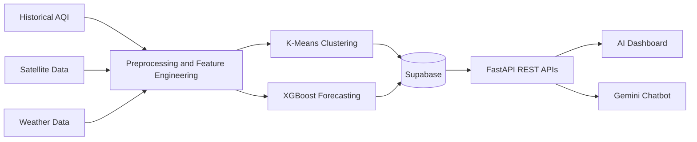
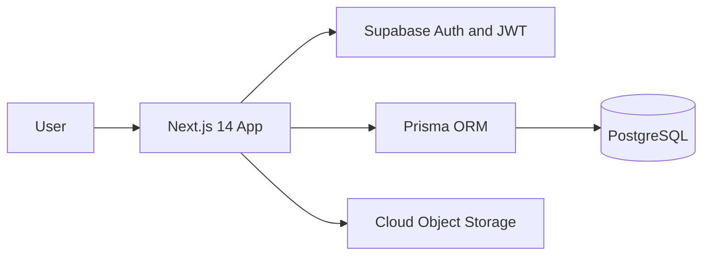
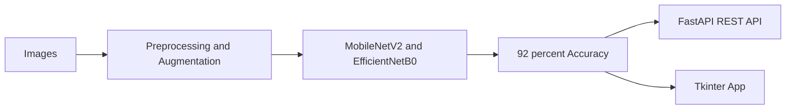

 

&nbsp;

&nbsp;

&nbsp;

  

<a href="#about">About</a> &nbsp;·&nbsp;
<a href="#tech-stack">Tech Stack</a> &nbsp;·&nbsp;
<a href="#featured-projects">Projects</a> &nbsp;·&nbsp;
<a href="#research--recognition">Research</a> &nbsp;·&nbsp;
<a href="#certifications">Certifications</a> &nbsp;·&nbsp;
<a href="#contact">Contact</a>

---

## About

CS undergraduate who builds things that go to production — not just demos. My work spans full-stack platforms with real authentication and database design, to machine learning pipelines trained on real-world data.

| | |
|:--|:--|
| 🎓 **Education** | B.Tech CSE (Information Technology), SRM University — GPA **9.22 / 10.0** |
| 📍 **Location** | Chennai, India |
| 🧭 **Focus** | Full-Stack Development · Machine Learning · Data Analytics |
| 🏅 **Certified** | AWS Data Engineer – Associate · SAP Generative AI Developer · AWS Cloud Practitioner |
| 📄 **Published** | IEEE paper at ISED 2025, NIT Raipur |
| 🟢 **Status** | Open to SWE & AI/ML internships |

---

## Tech Stack

<h4 align="center">Languages</h4>

  
  
  
  

<h4 align="center">Data Analytics</h4>

  
  
  

<h4 align="center">AI / GenAI</h4>

  
  
  
  
  

<h4 align="center">Backend, Cloud & Databases</h4>

  
  
  
  
  

<h4 align="center">Full-Stack & Tooling</h4>

  
  
  
  
  

  <b>Core CS</b> &nbsp;·&nbsp; REST APIs &nbsp;·&nbsp; DBMS &nbsp;·&nbsp; OOP &nbsp;·&nbsp; Data Structures &amp; Algorithms &nbsp;·&nbsp; Operating Systems &nbsp;·&nbsp; Computer Networks &nbsp;·&nbsp; SDLC 
  <b>Practices</b> &nbsp;·&nbsp; EDA &nbsp;·&nbsp; Data Preprocessing &nbsp;·&nbsp; Feature Engineering &nbsp;·&nbsp; Geospatial Visualization &nbsp;·&nbsp; Deep Learning &nbsp;·&nbsp; LLMs &nbsp;·&nbsp; Prompt Engineering

---

## Featured Projects

### SkyLy — Air Quality Intelligence Platform

&nbsp;

&nbsp;&nbsp;

&nbsp;

&nbsp;

Full-stack AQI intelligence platform processing **235K+ records across 291 Indian cities**, integrating historical AQI, satellite, and weather datasets for large-scale environmental analytics.

- **Data science** — EDA, preprocessing, and feature engineering (lag features, rolling statistics), with K-Means clustering to surface pollution trends and prepare data for predictive modeling.
- **AI dashboard** — AQI forecasting, geospatial visualization, historical trend analysis, and a **Gemini API chatbot** that gives personalized health insights and air quality recommendations.
- **Performance** — Scalable **FastAPI** REST APIs with parallelized multi-city data retrieval, cutting response latency by **50%+** for real-time analytics.

<b>Architecture</b>

 

  
  
  
  
  

---

### CloudDrive — Full-Stack Cloud Storage Platform

&nbsp;

&nbsp;&nbsp;

&nbsp;

&nbsp;

Secure cloud storage platform featuring authentication, file upload, search, sharing, storage analytics, and a responsive mobile-first interface.

- **Data layer** — Normalized relational schemas in **PostgreSQL**, with SQL-based retrieval through **Supabase Auth** and **Prisma ORM**.
- **File management** — End-to-end CRUD operations, access control, **soft delete / restore**, and cloud object storage, following scalable backend design practices.
- **Authentication** — Secure sign-in with **JWT** and protected access to user files.

<b>Architecture</b>

 

  
  
  
  
  

---

### Pothole Detection System — Transfer Learning

Computer vision classification system built with transfer learning on **MobileNetV2** and **EfficientNetB0**, achieving **92% classification accuracy**.

- **Data** — Image preprocessing, normalization, and augmentation expanded the dataset with **2,000+ images**, improving robustness and generalization.
- **Deployment** — Trained model served through a **FastAPI** REST API and a **Tkinter** application for real-time inference with confidence scores.

<b>Pipeline</b>

 

  
  
  
  

---

## Research & Recognition

> 📄 **"Intelligent Home Automation System with Weather Forecasting and Alert Integration"**
> Published IEEE research paper presented at the **International Symposium on Electronics & Devices (ISED 2025)**, hosted at **NIT Raipur**.

🏅 Ranked in the **Top 6%** of institutional SHL cognitive and aptitude assessments, demonstrating strong analytical and business reasoning ability.

---

## Certifications

| Credential | Issuer |
|:--|:--|
| 🏅 **AWS Certified Data Engineer – Associate** | Amazon Web Services |
| 🏅 **SAP Certified Generative AI Developer** | SAP |
| 🏅 **AWS Certified Cloud Practitioner** | Amazon Web Services |

---

## Education

**B.Tech — Computer Science with Specialisation in Information Technology**
SRM University, Kattankulathur, Chennai &nbsp;·&nbsp; `Aug 2023 – May 2027` &nbsp;·&nbsp; **GPA 9.22 / 10.0**

---

## GitHub Analytics

&nbsp;

---

## Contact

**Actively seeking SWE & AI/ML internship opportunities.**

&nbsp;

&nbsp;

&nbsp;

 

